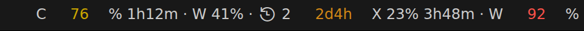

# Just Enough Quota Bar

A VS Code extension that shows your **Claude Code** and **Codex** subscription quota windows in the status bar. Nothing more.



- The 5-hour and the weekly quota window of Claude and Codex: used share and reset time.
- The redeemable (banked) resets: how many you have and when the first one expires.
- The next announced global reset, from a community tracker (optional).
- One format string per provider, so you choose exactly what is shown.
- Thresholds per variable: every coloured value gets its own colour.
- One shared cache for all VS Code windows on the machine, so more windows do not mean more requests.

## Contents

- [Installation](#installation)
- [Where the data comes from](#where-the-data-comes-from)
- [Format string](#format-string)
- [Thresholds](#thresholds)
- [Settings](#settings)
- [Status bar and tooltip](#status-bar-and-tooltip)
- [Privacy and security](#privacy-and-security)
- [Attribution](#attribution)
- [Troubleshooting](#troubleshooting)
- [Out of scope](#out-of-scope)
- [Development](#development)

## Installation

Install **Just Enough Quota Bar** (`tyutyutyu.just-enough-quota-bar`) from the [Visual Studio Marketplace](https://marketplace.visualstudio.com/items?itemName=tyutyutyu.just-enough-quota-bar) or from [Open VSX](https://open-vsx.org/extension/tyutyutyu/just-enough-quota-bar), or from the command line:

```sh
code --install-extension tyutyutyu.just-enough-quota-bar
```

A `.vsix` file can be installed with **Extensions: Install from VSIX…**.

Requirements:

- VS Code 1.140 or newer.
- **Claude:** you are logged in to [Claude Code](https://docs.claude.com/en/docs/claude-code) with a subscription. The extension uses the token Claude Code saved; it never logs in itself.
- **Codex:** you are logged in to the [Codex CLI](https://github.com/openai/codex) with a ChatGPT subscription. With the `codex` binary installed, the extension asks it; without it, see [the probe](#codex).

The extension always runs on your local machine (`extensionKind: ui`), also in Remote SSH, WSL and dev containers, so it uses the credentials of your local machine. A provider you do not use can be hidden with `jeqb.claude.enabled` or `jeqb.codex.enabled`.

## Where the data comes from

### Claude

The extension reads the OAuth token of Claude Code and asks the Claude usage endpoint, `GET https://api.anthropic.com/api/oauth/usage`, every 5 minutes.

- Token: `$CLAUDE_CONFIG_DIR/.credentials.json`, otherwise `~/.claude/.credentials.json`. On macOS also the Keychain item `Claude Code-credentials` (with a suffix when `CLAUDE_CONFIG_DIR` points elsewhere), read with the `security` tool; a valid Keychain token wins over the file.
- The token is only read. When it has expired, no request is sent: the extension keeps showing the last data as stale until Claude Code refreshes the token (see [`auth_expired`](#auth_expired)).
- The banked resets come from the `cedar_ember` block of the same answer. When the endpoint refuses that block, it is asked once more without it and the `banked.*` variables stay empty.

### Codex

`jeqb.codex.source` chooses where the Codex quota comes from:

- `auto` (default): `codex app-server` when the `codex` binary is found (`jeqb.codex.binaryPath`, otherwise `PATH`), the probe when it is not. The binary is looked up at every refresh, so installing it takes effect at once. A failing app-server does not switch to the probe.
- `appServer`: always the official `codex app-server`. The extension starts a short-lived `codex app-server` process, asks `account/rateLimits/read` over stdio and stops it, every 2 minutes. It uses no quota, and the extension itself makes no network request: Codex does the authentication.
- `probe`: always the probe.

**The probe uses a small amount of quota.** It reads the token of `$CODEX_HOME/auth.json` (or `~/.codex/auth.json`), lists the models, sends a minimal streamed `responses` request ("reply ok") and reads the limits from its `x-codex-*` response headers, then asks the reset credits. Because every run counts against your quota, it is only the fallback for a machine without the `codex` binary and runs at most every 10 minutes: `jeqb.codex.probeIntervalMinutes` defaults to 10, and a smaller value is raised to 10. The machine-wide cache keeps several VS Code windows from multiplying the requests.

### Announced resets

The vendors sometimes reset everybody's limits at once and announce it. The `announced.*` variables show the next announced reset from a third-party community tracker, chosen per provider:

| Setting | Values | Default |
|---|---|---|
| `jeqb.claude.announcedSource` | `whenreset`, `off` | `whenreset` |
| `jeqb.codex.announcedSource` | `whenreset`, `codexReset`, `off` | `whenreset` |

- [whenreset.app](https://whenreset.app/) covers both providers: the announced resets, the last regular reset and the chance of a reset within 24 and 48 hours.
- [codex-reset.com](https://codex-reset.com/) covers Codex only and gives no announced time: just `announced.p24`, `announced.p48` and `announced.last`.

A tracker is only asked while the provider's format uses an `announced.*` variable, then every 30 minutes, with an identifying `User-Agent` that links this project. When the tracker fails, only the `announced.*` variables are missing; the quota itself is not affected.

## Format string

`jeqb.claude.format` and `jeqb.codex.format` set the status bar text of each provider. The syntax is Python-like:

- `{variable}` or `{variable:spec}` inserts a value.
- `{{` and `}}` are a literal `{` and `}`.
- VS Code icons, `$(codicon-name)`, are kept, for example `$(history)`.
- A missing value is shown as `jeqb.missingValue` (default `–`).
- An unknown variable or a bad spec makes the format invalid: the provider shows `$(warning) Claude` (or `Codex`) and the tooltip lists the problems. The extension keeps running.

### Variables

Every variable belongs to the provider of the format.

| Variable | Type | Meaning |
|---|---|---|
| `5h.pct` | number, 0–100 | Used share of the 5-hour window. |
| `5h.left` | number, 0–100 | Remaining share of the 5-hour window: 100 − `5h.pct`. |
| `5h.reset` | time | Reset of the 5-hour window. |
| `week.pct` | number, 0–100 | Used share of the weekly window. |
| `week.left` | number, 0–100 | Remaining share of the weekly window. |
| `week.reset` | time | Reset of the weekly window. |
| `banked.count` | number | Number of redeemable (banked) resets. |
| `banked.expires` | time | Expiry of the banked reset that expires first: redeem it before this. |
| `announced.next` | time | Next announced global reset, or the tracker's estimate (see `jeqb.announced.includeEstimates`). |
| `announced.kind` | text | `announced`, `hinted` or `estimate`. |
| `announced.last` | time | Last regular global reset. |
| `announced.p24` | number, 0–100 | Chance of a global reset within 24 hours, when the tracker gives it. |
| `announced.p48` | number, 0–100 | Chance of a global reset within 48 hours, when the tracker gives it. |
| `name` | text | `Claude` or `Codex`. |

### Specs

| Type | Spec | Examples |
|---|---|---|
| number | `[[fill]align][width][.precision]`; align is `<`, `>` or `^`, right by default; integers by default | `{5h.pct:>3}` → ` 42`, `{week.left:.1}` → `33.5`, `{5h.pct:0>3}` → `042` |
| time | `rel` (default): the time left, two largest units | `{5h.reset}` → `1h12m`, `{week.reset:rel}` → `2d3h` |
| time | `iso`: UTC ISO 8601 | `{week.reset:iso}` → `2026-10-30T14:00:00Z` |
| time | strftime subset in local time: `%a` weekday, `%d` day, `%H` hour, `%M` minute, `%b` month name, `%m` month, `%Y` year, `%%` | `{week.reset:%a %H:%M}` → `Thu 16:00` |
| text | `[[fill]align][width]`; left by default | `{announced.kind:>9}` |

A reset in the past is shown as `0m` in the `rel` style, so use `%d %b` or `iso` for `announced.last`.

### Examples

```jsonc
// The defaults → C 42% 1h12m · W 67%
"jeqb.claude.format": "C {5h.pct}% {5h.reset:rel} · W {week.pct}%",
"jeqb.codex.format": "X {5h.pct}% {5h.reset:rel} · W {week.pct}%",

// Remaining share, weekly reset as a weekday, banked resets and the next announced reset
// → C 58% · W 67% Thu 16:00 · $(history) 2 2d4h · ⚡3h
"jeqb.claude.format": "C {5h.left}% · W {week.pct}% {week.reset:%a %H:%M} · $(history) {banked.count} {banked.expires:rel} · ⚡{announced.next:rel}",

// The chance of a global Codex reset → X 23% · reset 24h: 12%
"jeqb.codex.format": "X {5h.pct}% · reset 24h: {announced.p24}%"
```

## Thresholds

A VS Code status bar item has one colour, so every variable that gets a colour from a threshold becomes its own status bar item; the literal text and the uncoloured variables between them are merged into neutral items. The order of the format is kept (`jeqb.<provider>.priority`, minus one for every further item); VS Code leaves a small fixed gap between adjacent items.

`jeqb.thresholds` holds the global thresholds; `jeqb.claude.thresholds` and `jeqb.codex.thresholds` replace single keys of it for one provider. The key is the variable name, the value a list of steps:

```jsonc
// The default
"jeqb.thresholds": {
  "5h.pct": [
    { "gte": 70, "color": "charts.yellow" },
    { "gte": 90, "color": "errorForeground", "background": "error" }
  ],
  "week.pct": [
    { "gte": 70, "color": "charts.yellow" },
    { "gte": 90, "color": "errorForeground" }
  ],
  "banked.expires": [
    { "lte": "3d", "color": "charts.orange" },
    { "lte": "1d", "color": "errorForeground" }
  ]
},
// Codex only: warn earlier about the weekly window, and highlight an announced reset
"jeqb.codex.thresholds": {
  "week.pct": [{ "gte": 50, "color": "charts.yellow" }, { "gte": 80, "color": "charts.red" }],
  "announced.kind": [{ "eq": "announced", "color": "charts.green" }]
}
```

Rules:

- Every step has exactly one condition and a `color`:
  - `gte`, `gt`, `lte`, `lt` compare a number variable with a number, or a time variable with a duration such as `"90m"`, `"3d"` or `"1.5h"` (units `s`, `m`, `h`, `d`). A time variable compares the **time left** until it.
  - `eq` compares a text variable (`announced.kind`, `name`) with a text.
- The steps are evaluated in order and the **last matching step wins**, so increasing steps can be written one after the other.
- `color` is a [theme colour ID](https://code.visualstudio.com/api/references/theme-color) such as `charts.red` or `errorForeground`, or `#rrggbb`.
- `background` is optional and can only be `warning` or `error`: VS Code allows no other status bar background.
- Stale data is drawn in `jeqb.staleColor` (default `disabledForeground`), above every threshold.
- An invalid step (unknown variable, two conditions, a duration for a number) makes the provider show `$(warning)` with the problem in the tooltip.

## Settings

| Setting | Default | Description |
|---|---|---|
| `jeqb.alignment` | `right` | Side of the status bar: `left` or `right`. |
| `jeqb.missingValue` | `–` | Text shown for a variable without a value. |
| `jeqb.staleColor` | `disabledForeground` | Colour of stale data, above every threshold. |
| `jeqb.thresholds` | see [Thresholds](#thresholds) | Global thresholds by variable name. |
| `jeqb.announced.includeEstimates` | `false` | When nothing is announced, show whenreset's estimate of the next reset as `announced.next`, with `announced.kind` = `estimate`. A passed estimate counts as missing. |
| `jeqb.claude.enabled` | `true` | Show the Claude quota. |
| `jeqb.claude.format` | `C {5h.pct}% {5h.reset:rel} · W {week.pct}%` | Claude format string. |
| `jeqb.claude.priority` | `200` | Priority of the first Claude item; higher is further left. |
| `jeqb.claude.thresholds` | `{}` | Claude thresholds; each key replaces the same key of `jeqb.thresholds`. |
| `jeqb.claude.announcedSource` | `whenreset` | `whenreset` or `off`. |
| `jeqb.codex.enabled` | `true` | Show the Codex quota. |
| `jeqb.codex.format` | `X {5h.pct}% {5h.reset:rel} · W {week.pct}%` | Codex format string. |
| `jeqb.codex.priority` | `100` | Priority of the first Codex item; higher is further left. |
| `jeqb.codex.thresholds` | `{}` | Codex thresholds; each key replaces the same key of `jeqb.thresholds`. |
| `jeqb.codex.announcedSource` | `whenreset` | `whenreset`, `codexReset` or `off`. |
| `jeqb.codex.source` | `auto` | `auto`, `appServer` or `probe`; see [Codex](#codex). |
| `jeqb.codex.binaryPath` | empty | Path of the `codex` executable (machine setting). Empty: the first `codex` (on Windows `codex.exe` or `codex.cmd`) on the `PATH`. |
| `jeqb.codex.probeIntervalMinutes` | `10` | Minutes between two probe runs; never less than 10. |

## Status bar and tooltip

- **Click** a quota item, or run **Just Enough Quota Bar: Refresh quota** (`jeqb.refresh`), to ask for fresh data now. The minimum interval of the source still applies (Claude 1 minute, Codex app-server 30 seconds, probe 10 minutes).
- **Hover** shows the provider and its source (`OAuth usage`, `app-server` or `probe`), the time of the last update, the stale state or the error code, and the credit of the announced-reset tracker.
- The relative times are redrawn every 30 seconds without a request. When a window's reset time passes, it reads `0%` and counts as stale until the next successful refresh.
- After a failed refresh the last data stays, marked stale, and the next attempt backs off exponentially up to 30 minutes; a `Retry-After` header of a `429` answer is respected, up to 24 hours.

## Privacy and security

Just Enough Quota Bar has **no telemetry** and no server of its own. It only reads your quota; it never redeems a reset or changes anything on your account.

### Hosts the extension connects to

| Host | When | What |
|---|---|---|
| `api.anthropic.com` | Claude is enabled | `GET /api/oauth/usage`, with your Claude Code OAuth token. **Undocumented endpoint.** |
| `chatgpt.com` | only when the Codex source is the probe | `GET /backend-api/codex/models`, a minimal `POST /backend-api/codex/responses` and `GET /backend-api/wham/rate-limit-reset-credits`, with your Codex token. **Undocumented endpoints; the `responses` request uses a small amount of quota** on every run, at most every 10 minutes. |
| `whenreset.app` | the format uses an `announced.*` variable and the source is `whenreset` | `GET /api/v1/latest.json` and `GET /api/forecast?product=claude` or `codex`. No token and no account data. |
| `codex-reset.com` | the Codex format uses an `announced.*` variable and the source is `codexReset` | `GET /api/forecast`. No token and no account data. |

With the Codex app-server (the default when `codex` is installed), the extension sends nothing over the network for Codex: it runs the local `codex app-server`, and Codex makes the request with its own login.

### What the extension reads locally

- `$CLAUDE_CONFIG_DIR/.credentials.json` or `~/.claude/.credentials.json`: the Claude Code access token and its expiry.
- macOS: the Keychain item of Claude Code (`Claude Code-credentials…`), through `security find-generic-password`.
- `$CODEX_HOME/auth.json` or `~/.codex/auth.json`: the Codex access token and account ID, **only for the probe**.
- The `PATH` (or `jeqb.codex.binaryPath`) to find the `codex` binary, which it runs as `codex app-server`.
- Its own settings and its cache.

### Tokens

- Tokens are **only read**. The extension never writes a credential file or Keychain item, never refreshes a token, and never logs in.
- Tokens are **never cached**: the shared cache (`cache.json` in the extension's global storage) holds only derived data, that is percentages, times, counts and error codes. Every entry is rebuilt from these known fields before it is written, so nothing else from an answer can reach the file.
- Tokens are **never logged**: the output channel *Just Enough Quota Bar* only gets error messages and, for an unexpected whenreset answer, the keys and types of its shape, never its content. The tooltip shows non-sensitive error codes only.

### Undocumented endpoints

The Claude usage endpoint and the Codex probe endpoints are not public, documented APIs. They can change or disappear without notice. When their answer changes, the extension shows an error code (for example `invalid_usage_response` or `invalid_quota_headers`) and the last data as stale instead of failing. The Codex app-server, the default when `codex` is installed, is the official interface of the Codex CLI.

## Attribution

The announced resets come from third-party community trackers with their own terms; the extension credits and links the active tracker in the tooltip of every provider whose format uses an `announced.*` variable.

- **[whenreset.app](https://whenreset.app/)**: announced and past global resets of Claude and Codex, and the reset forecast. Shown as *Data: whenreset.app*.
- **[codex-reset.com](https://codex-reset.com/)**: the Codex reset forecast. Shown as *Data: codex-reset.com*, as its terms require.

Thanks to both projects. Their data is provided as is; this extension is not affiliated with them, nor with Anthropic or OpenAI.

## Troubleshooting

The tooltip of a provider shows its state: `Stale: <code>` while old data is shown after a failed refresh, `Error: <code>` when there is no data yet. **Just Enough Quota Bar: Refresh quota** retries at once.

### Stale data

The values are drawn in `jeqb.staleColor` and the tooltip says `Stale` with the error code of the last attempt. Usual causes:

- `network_error` or `timeout`: no connection, a proxy or a slow answer. It recovers by itself.
- `upstream_429`: rate limited; the next attempt waits for `Retry-After` (at most 24 hours) or the backoff (at most 30 minutes).
- `upstream_401` or `upstream_403`: the token was rejected; log in again in Claude Code or Codex.
- `invalid_usage_response`, `invalid_rate_limits_response`, `invalid_quota_headers`, `invalid_announced_response`: the answer had an unexpected format, likely because an undocumented endpoint changed. Please [open an issue](https://github.com/tyutyutyu/just-enough-quota-bar/issues).
- `Stale` without a code: a window's reset time has passed since the last refresh, so it shows `0%` until the next one.

Several VS Code windows share one cache and one refresh per source, so a stale value is stale in every window.

### `auth_expired`

The Claude Code token has expired. The extension never refreshes it, so it sends no request and keeps the last data as stale; the tooltip says *Run Claude Code to refresh the token.* Run any Claude Code command (or start Claude Code) and the next refresh picks up the new token.

Related codes: `auth_missing` (no credential found: log in to Claude Code, or check `CLAUDE_CONFIG_DIR`), `auth_blank` (the saved token is empty: log in again), `auth_invalid` (the credential file cannot be read or parsed). The Codex probe uses `auth_missing` and `auth_invalid` for `auth.json` in the same way.

### No `codex` binary

- With `jeqb.codex.source` = `auto`, a missing `codex` binary silently switches to the probe, which **uses a small amount of quota**. The tooltip source reads `probe`. Install the [Codex CLI](https://github.com/openai/codex) or set `jeqb.codex.binaryPath` to use the app-server instead.
- With `appServer`, the error code is `codex_not_found`. VS Code may not see the `PATH` of your shell (for example when started from a desktop launcher); set `jeqb.codex.binaryPath` to the full path of `codex` (`which codex`, on Windows `where codex`).
- `spawn_failed`, `process_exited`, `rpc_error` or `timeout` with the app-server: `codex` was found but did not answer. Check that `codex app-server` runs in a terminal and that you are logged in (`codex login`).

### Invalid configuration

The provider shows `$(warning) Claude` or `$(warning) Codex` and the tooltip lists every problem of the format string or the thresholds, for example an unknown variable or an unsupported time directive. Fix the setting and the bar updates at once.

## Out of scope

This extension deliberately does **not** provide:

- history, charts, consumption or usage analytics, pace or forecasts;
- alerts or notifications;
- dashboards or webviews;
- redeeming resets or any other write action;
- other providers, or multiple accounts per provider.

## Development

Requirements: Node.js 24, [Task](https://taskfile.dev) and, on Linux, `xvfb` for the integration test.

```sh
npm ci
task verify
```

`task verify` runs ESLint, the TypeScript type check, the Vitest unit tests (≥ 80 % branch coverage), the `@vscode/test-electron` integration test and the `vsce package` check. The same command runs in GitHub Actions on Linux, macOS and Windows, next to CodeQL and gitleaks.

- `src/format`: format-string parser and renderer.
- `src/thresholds`: threshold parsing and evaluation.
- `src/cache`: machine-wide shared cache, lock files, backoff and file watching.
- `src/sources`: the Claude, Codex (app-server, probe, source selection) and announced-reset sources. All I/O is injected, so they are unit tested without network.
- `src/statusbar`: settings, layout into status bar items, tooltip and the controller.
- `test/unit` (Vitest) and `test/integration` (VS Code extension host).

Run `npm run build`, then start an Extension Development Host with `code --extensionDevelopmentPath=.`. `task extension:install` packages the extension and installs the `.vsix` into VS Code; `task extension:install CODE_CLI=code-insiders` installs it into VS Code Insiders. The design and its decisions live in the project's Backlog document *Just Enough Quota Bar – terv és specifikáció* (`doc-1`).

### Release

1. Add the new version to [CHANGELOG.md](CHANGELOG.md) and set the same `version` in `package.json` (`npm version <version> --no-git-tag-version`).
2. Merge to `main`, then push a tag `v<version>`, for example `git tag v0.0.1 && git push origin v0.0.1`.
3. The [Publish workflow](.github/workflows/publish.yml) checks that the tag matches `package.json`, packages the extension once and publishes the same `.vsix` to the Visual Studio Marketplace and to Open VSX.

The workflow needs two repository secrets: `VSCE_PAT` (an Azure DevOps token with the *Marketplace: Manage* scope for the `tyutyutyu` publisher) and `OVSX_PAT` (an Open VSX access token). Before the first release, the `tyutyutyu` namespace must exist on Open VSX (`npx ovsx create-namespace tyutyutyu -p <token>`).

## License

[MIT](LICENSE)
